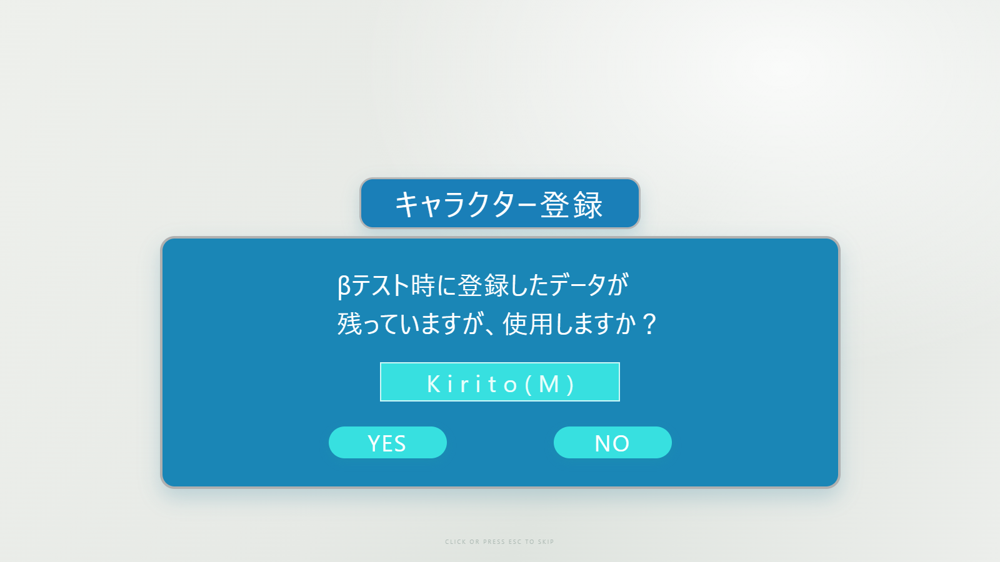

# DSH SAO Link Start

[中文](#中文说明) · [English](#english)

An unofficial, procedural recreation of an SAO-style login sequence for
DeepSeek Harness. It plays as a full-screen overlay when the Harness UI starts,
then removes itself automatically.

The plugin contains no anime footage, images, fonts, or game assets. Its tunnel,
HUD dials, panels, and sound cues are generated with Canvas, CSS, SVG, and Web
Audio.

| Beam tunnel | Character confirmation |
| --- | --- |
|  |  |

## English

### Features

- Perspective capsule-beam tunnel with near-camera clipping to prevent flashes.
- Five animated cyan HUD dials followed by language, login, and character
  registration panels.
- A dedicated **Settings → SAO Link Start** page.
- Adjustable beam speed, beam length, beam density, and HUD dial size.
- Editable language and character labels; defaults are `Japanese` and
  `Kirito(M)`.
- Click or press `Escape` to skip. Press `Ctrl+Alt+L` to replay while the
  Harness page has keyboard focus.
- Respects reduced-motion preferences.

### Install

Replace `desktop` with the profile you use:

```sh
dsh plugin --profile desktop add github:liyansong0015/dsh-sao-link-start
```

Restart Harness after installation. Open the account menu, choose **Settings**,
then select **SAO Link Start** in the left navigation.

### Configuration

| Field | Range/default | Effect |
| --- | --- | --- |
| Beam speed | `0.4–2.5`, default `1` | Fly-through speed |
| Beam length | `0.4–2.5`, default `1` | Capsule trail length |
| Beam density | `0.4–2`, default `1` | Number of visible beams |
| Dial size | `0.35–1.2`, default `0.65` | Scale of the five HUD dials |
| Language name | default `Japanese` | Label beside the Language pill |
| Character name | default `Kirito(M)` | Name in the registration dialog |

Save settings and restart Harness to preview the new values.

### Permissions and network use

The plugin adds a startup overlay and a settings section. It does not request
credentials, read conversations or workspace files, or make network requests.

## 中文说明

这是一个非官方的 DeepSeek Harness 启动动画插件，以程序绘制方式重现
SAO 风格的登录流程。Harness 界面启动时会显示全屏动画，播放结束后自动卸载。

插件不包含动画原片、图片、字体或游戏素材。光束隧道、HUD 圆盘、界面和音效均由
Canvas、CSS、SVG 与 Web Audio 实时生成。

### 功能

- 带近相机裁剪的透视胶囊光束隧道，避免光束穿过镜头时闪屏。
- 五个青色 HUD 圆盘，以及语言、登录、角色确认界面。
- 独立的 **设置 → SAO 连结开始动画** 页面。
- 可调光束速度、光束长度、光束数量与圆盘大小。
- 可编辑语言名称和人物名称，默认分别为 `Japanese` 与 `Kirito(M)`。
- 点击画面或按 `Escape` 跳过；Harness 页面获得键盘焦点时，可按
  `Ctrl+Alt+L` 重播。
- 支持系统的减少动态效果偏好。

### 安装

把 `desktop` 换成你实际使用的配置名称：

```sh
dsh plugin --profile desktop add github:liyansong0015/dsh-sao-link-start
```

安装后重启 Harness。从账号菜单打开**设置**，在左侧选择
**SAO 连结开始动画**即可调节参数。

### 权限与联网

插件只注册启动遮罩和设置栏目，不读取对话或工作区文件，不请求凭据，也不会发起
网络请求。

## Attribution

The beam concept and palette were adapted from
[unixzii/SAOLinkStart](https://github.com/unixzii/SAOLinkStart), released under
The Unlicense. This project is also released under The Unlicense.

Sword Art Online and related names are trademarks of their respective owners.
This fan project is not affiliated with or endorsed by the rights holders.
